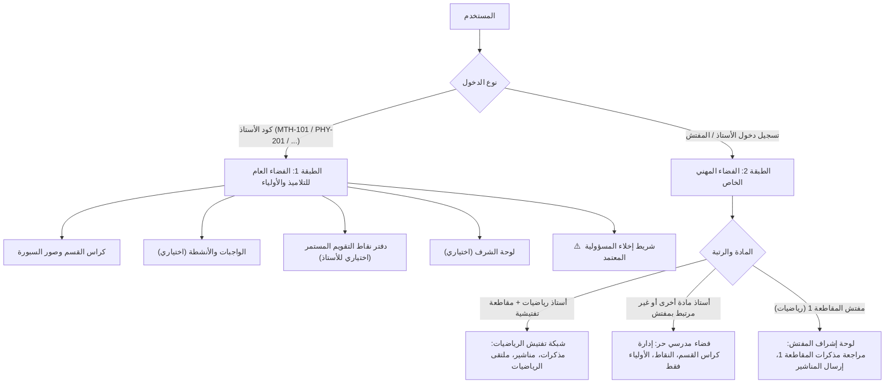

# 🏛️ وثيقة المواصفات الهندسية والمعمارية للمنصة التعليمية المطورة
## منصة الفضاءات البيداغوجية المستقلة وشبكة رياضيات ولاية الوادي

---

## 1. الرؤية العامة والأهداف الاستراتيجية (Executive Vision)

تهدف المنصة إلى تقديم حل مزدوج ذكي يجمع بين:
1. **تطلعات مفتشية الرياضيات لولاية الوادي:** بيئة تفتيشية رسمية ومغلقة للمقاطعات، متابعة المذكرات التربوية، تبادل التوجيهات البيداغوجية الرسمية، وملتقى مهني تخصصي.
2. **رغبة مدراء المؤسسات التعليمية (كالسيد باهي علي):** إتاحة فضاء رقمي تواصلي منظم لجميع أساتذة المتوسطة بمختلف المواد لتوثيق كراس القسم، الواجبات، ونقاط التقويم المستمر مع الأولياء.
3. **درع الحماية القانونية والإدارية:** إخلاء مسؤولية مطور ومسؤول المنصة بشكل قاطع من أي خطأ صادر عن أي أستاذ عبر نظام تعهد إلكتروني، بصمة رقمية، ومساحات عمل مستقلة تماماً.
4. **حرية الأستاذ واختلاف أهدافه:** إتاحة نظام مفاتيح تفعيل مرن (Modular Feature Toggles) يُمكّن كل أستاذ من اختيار الأدوات التي تناسب طريقته (مثل نشر نقاط التقويم المستمر، أو الاكتفاء بالسبورة فقط).

---

## 2. الهيكل المعماري ثنائي الطبقات (Dual-Layer Architecture)



---

## 3. درع الحماية القانونية والإدارية (Legal Liability Shield)

لحماية صاحب المنصة والمؤسسة من أي تبعات قانونية أو إدارية:

### أ) ميثاق الاستخدام البيداغوجي والتعهد الإلكتروني (Pedagogical Pledge)
عند إنشاء أي حساب جديد في شاشة التسجيل (`/register`):
* يُلزم الأستاذ بقراءة والموافقة الإجبارية (Checkbox Check) على بند التعهد:
> **«أتعهد أنا الأستاذ المسجل بصحة هويتي وممارستي لمهنة التدريس، وأقر بأن كافة المواد والصور والمحتويات والبيانات التي أقوم بنشرها عبر فضائي تقع تحت مسؤوليتي التربوية والقانونية الحصرية. كما أقر بأن إدارة المنصة مجرد وسيط تقني لا يتحمل أي مسؤولية مدنية أو إدارية أو جزائية عن أي محتوى غير لائق أو مخالف للتنظيم التربوي المعمول به.»**
* يُخزن توقيت وتاريخ القبول وعنوان IP ورقم الهاتف في جدول `profiles.terms_accepted_at`.

### ب) شريط إخلاء المسؤولية الرسمي التلقائي (Safe Harbor Banner)
يظهر كشريط دائم وواضح في تذييل كل صفحة أستاذ وكل درس وكل لوحة نقاط:
> 🛡️ **إشعار مسؤولية النشر:** هذا الفضاء يُدار شخصياً ومستقلاً من طرف **الأستاذ(ة) [الاسم الكامل]** لمادة **[المادة]** بمؤسسة **[اسم المتوسطة]**. المحتوى منشور بمسؤوليته البيداغوجية الحصرية.

### ج) البصمة الرقمية وسجل العمليات (Audit Trail)
* كل عملية رفع صورة، مذكرة، أو تعديل نقطة تُسجل في قاعدة البيانات مع: `(user_id, action, timestamp, ip_address)`.
* زر «إبلاغ الإدارة 🚩» متاح للأولياء والتلاميذ لتجميد أي محتوى غير مناسب فوراً.

---

## 4. نظام المفاتيح المعيارية للأستاذ (Modular Feature Toggles)

في لوحة تحكم الأستاذ (`/admin`)، يُضاف قسم إعدادات الفضاء:

```json
{
  "features": {
    "board_lessons": true,        // كراس القسم والسبورة (إجباري/افتراضي)
    "homework": true,             // الواجبات والأنشطة المنزلية
    "continuous_assessment": true,// دفتر نقاط التقويم المستمر (ميزة الشفافية)
    "honor_roll": true,           // لوحة الشرف وتكريم المتفوقين
    "reception_schedule": true,   // جدول وتوقيت استقبال الأولياء
    "announcements": true,        // الإعلانات المدرسية
    "inspector_sync": false       // الربط مع المفتشية البيداغوجية (اختياري)
  }
}
```

* **إذا عطّل الأستاذ ميزة (مثلاً نقاط التقويم المستمر):**
  * تختفي علامة التبويب تماماً من صفحته العامة أمام الأولياء، ولا تظهر أي إشارة لها.
* **إذا فعّلها الأستاذ:**
  * تنشط الواجهة ويستطيع تعبئة البيانات براحة وسهولة.

---

## 5. ميزة دفتر نقاط التقويم المستمر (Continuous Assessment Ledger)

تُعد هذه الميزة إضافة فارقة لتحقيق الشفافية التي طلبها الأستاذ:

### أ) معايير شبكة التقييم الجزائرية (Grille d'Évaluation)
| المعيار البيداغوجي | النقطة الجزئية | التوصيف الميداني |
| :--- | :---: | :--- |
| **كراس القسم وتنظيم الدرس** | **04 / 04** | اكتمال الدروس المنقولة من السبورة، النظافة، استعمال الألوان |
| **الانضباط والمواظبة والمشاركة** | **04 / 04** | الحضور في الوقت، المشاركة الإيجابية، تجنب التشويش |
| **إنجاز الواجبات والمهام المنزلية** | **04 / 04** | إحضار المحاولات المنزلية وحل التمارين بانتظام |
| **الاستجوابات والتقويم المرحلي** | **08 / 08** | الفروض الفجائية، الاستجوابات السريعة، الأنشطة الفردية |
| **المجموع النهائي** | **20 / 20** | النقطة الإجمالية للتقويم المستمر للثلاثي |

### ب) خيارات حماية الخصوصية (Privacy Modes)
يتيح الأستاذ أحد الخيارين لعرض النقاط:
1. **العرض الآمن بواسطة رقم التلميذ (قائمة القسم):** الولي يكتب رقم تلميذه في القائمة (مثال: الفوج 4م2 - التلميذ رقم 14) فتظهر له بطاقة تقييم ابنه فقط دون إحراج بقية التلاميذ.
2. **جدول الشفافية العام (متاح لمن يرغب الأستاذ):** عرض الدرجات مع إمكانية إظهار الحروف الأولى فقط من اللقب والاسم (مثل: ع. صهيب).

---

## 6. استراتيجية المواد المتعددة والمفتشيات (Multi-Subject Strategy)

1. **الأساتذة المسجلون في مادة الرياضيات:**
   - يتبعون المقاطعة المحددة (المقاطعة 1 إلى 5).
   - تتاح لهم خدمة إرسال المذكرات للمفتش، الاطلاع على مناشير المفتش، والمشاركة في ملتقى الرياضيات.
2. **الأساتذة المسجلون في مواد أخرى (فيزياء، علوم، لغة عربية، فرنسية...):**
   - فضائهم يعمل كفضاء مدرسي تواصلي كامل مع أولياء تلاميذهم.
   - قسم المفتش والمذكرات التفتيشية يكون معطلاً تلقائياً لعدم وجود مفتش مسجل للمادة في تلك المقاطعة.
   - المنتدى التخصصي يكون معزولاً حسب المادة (`category = subject`).

---

## 7. لوحة إشراف مدير المتوسطة (Principal Dashboard - باهي علي)

لتلبية طلب مدير المؤسسة باهي علي وتمكينه من المتابعة:
* يُنشأ حساب برتبة `principal` مرتبط بمؤسسته (`middle_school_id`).
* **صلاحيات المدير:**
  1. رؤية قائمة كافة أساتذة متوسطته المسجلين بجميع المواد.
  2. الاطلاع السريع على إحصائيات النشاط: (كم درساً رُفع هذا الأسبوع؟ هل نُشرت الواجبات؟).
  3. صلاحية إيقاف مؤقت لأي حساب أستاذ في حال وجود شكوى أو تجاوز حتى مراجعته.
  4. استخراج تقرير دوري للإدارة عن التواصل الرقمي مع الأولياء.
